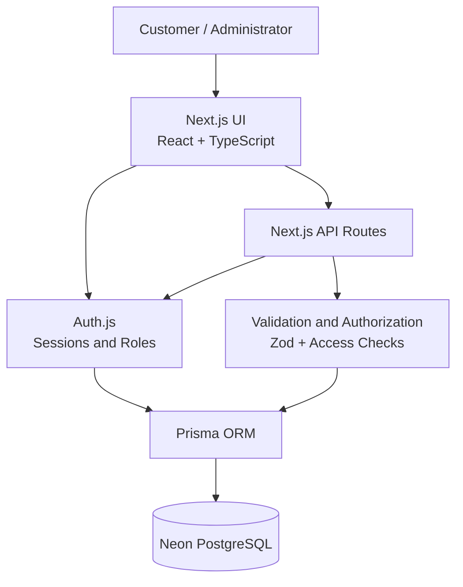
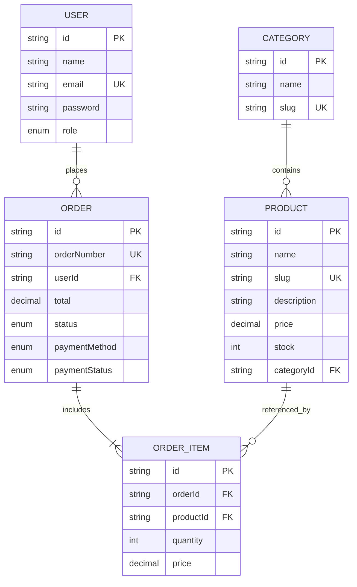
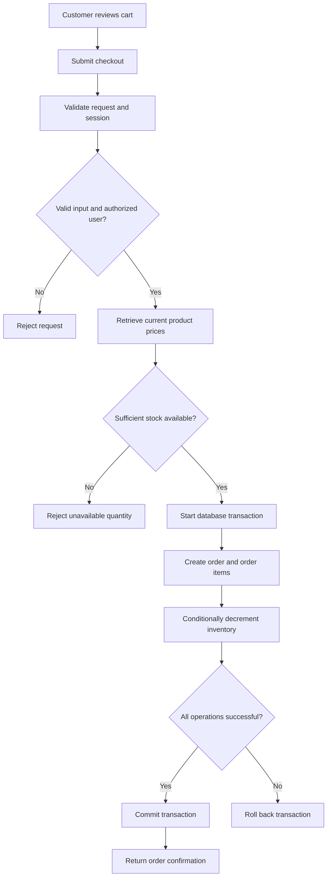

# E-Commerce Website

A full-stack e-commerce web application built with **Next.js, TypeScript, Prisma ORM, and PostgreSQL**. The project includes product discovery, shopping cart management, authentication, role-based access control, order processing, and an administrative dashboard.

## Table of Contents

- [Overview](#overview)
- [Features](#features)
- [Technology Stack](#technology-stack)
- [Architecture](#architecture)
- [Database Design](#database-design)
- [Order Processing Flow](#order-processing-flow)
- [Project Structure](#project-structure)
- [Getting Started](#getting-started)
- [Environment Variables](#environment-variables)
- [Database Setup](#database-setup)
- [Demo Accounts](#demo-accounts)
- [API Reference](#api-reference)
- [Security and Data Integrity](#security-and-data-integrity)
- [Running the Application](#running-the-application)
- [Future Improvements](#future-improvements)
- [License](#license)

## Overview

This project demonstrates the development of a database-driven online store with separate customer and administrator experiences.

Customers can browse products, search and filter the catalog, add products to a persistent browser-side cart, place orders, and manage their purchases. Administrators can manage products, review orders, and update order statuses through a protected dashboard.

The application uses Next.js App Router for page rendering and API routes, Auth.js for authentication, Prisma for database access, and Neon-hosted PostgreSQL for persistent storage.

**Payment note:** The current implementation supports Cash on Delivery (COD) and a mock card-payment flow. It does not process real card payments through a payment gateway.

## Features

### Customer storefront

- Responsive homepage and product catalog.
- Product details with descriptions, prices, images, and stock information.
- Search, category filtering, and product sorting.
- Shopping cart with quantity management and cart item count.
- Cart persistence using browser local storage.
- Checkout with shipping details and supported payment methods.
- Order confirmation and order history.
- Order cancellation where permitted.
- Light and dark themes with saved preferences.
- Loading states and interactive UI components.

### Authentication and authorization

- User registration and login.
- Password hashing using `bcryptjs`.
- Input validation with Zod.
- Session management using Auth.js and JWT-based sessions.
- Role-based access control for `USER` and `ADMIN` accounts.
- Protected administrative routes and APIs.
- Server-side enforcement of user ownership for private order data.
- Registration always assigns the customer role, preventing clients from registering themselves as administrators.

### Administration

- Dashboard with store metrics.
- Product creation and management.
- Product category assignment.
- Inventory and product information management.
- Order listing and status updates.
- Protected administrative operations.

### Database and order integrity

- Relational PostgreSQL database.
- Prisma schema and database client.
- Seed data for categories, products, and demonstration accounts.
- Server-side price calculation during checkout.
- Transactional order creation and stock updates.
- Inventory restoration when an eligible order is cancelled.

## Technology Stack

| Technology | Purpose |
|---|---|
| Next.js App Router | Application routing, rendering, and API endpoints |
| React 19 | Component-based user interface |
| TypeScript | Static typing |
| Tailwind CSS v4 | Styling and responsive layouts |
| Auth.js v5 | Authentication and session management |
| Prisma ORM 6 | Database access and relational data modeling |
| PostgreSQL | Persistent application database |
| Neon | Managed PostgreSQL hosting |
| bcryptjs | Password hashing |
| Zod | Server-side and form input validation |
| Framer Motion | UI animations, where implemented |
| Lucide React | Interface icons |
| next-themes | Light and dark theme management |

## Architecture

The application follows a layered architecture. The frontend communicates with Next.js API routes for mutations and protected operations. API handlers validate input, verify authorization, and interact with PostgreSQL through Prisma.



### Architectural responsibilities

- **Presentation layer:** Pages and reusable React components display products, cart contents, forms, order details, and admin controls.
- **Authentication layer:** Auth.js verifies credentials and provides session information, including user roles.
- **API layer:** Route handlers process registration, checkout, product administration, order cancellation, and status updates.
- **Validation and authorization layer:** Incoming data is validated and permissions are checked before protected operations.
- **Data layer:** Prisma performs database queries and transactions against PostgreSQL.

## Database Design

The database uses relational models for users, categories, products, orders, and order items.



### Entity descriptions

| Entity | Responsibility |
|---|---|
| `User` | Stores account information and the user's role. |
| `Category` | Groups related products. |
| `Product` | Stores product details, pricing, category, and inventory. |
| `Order` | Represents a customer's purchase, payment method, and order status. |
| `OrderItem` | Stores the products and quantities belonging to an order, including the recorded item price. |

The `OrderItem` model separates individual purchased items from the overall order. Recording the item price at purchase time helps preserve the order's historical pricing when catalog prices change later.

The exact field types, constraints, and relations are defined in `prisma/schema.prisma`.

## Order Processing Flow

The checkout process must not trust product prices or inventory quantities supplied by the browser. The server retrieves the authoritative product data and processes stock changes with the order.



### Order integrity principles

1. The server calculates the order total from current database prices.
2. Stock availability is checked on the server.
3. Inventory changes and order creation use a database transaction.
4. Conditional stock updates help prevent overselling when multiple customers purchase the same product.
5. Order access is restricted to the owning customer or an appropriately authorized administrator.
6. Cancellation must restore inventory only when the cancellation is valid and the stock restoration has not already been applied.

## Project Structure

```text
Ecommerce/
├── prisma/
│   ├── schema.prisma
│   └── seed.ts
├── public/
│   └── ...
├── src/
│   ├── app/
│   │   ├── (auth)/
│   │   │   ├── login/
│   │   │   └── register/
│   │   ├── admin/
│   │   │   ├── orders/
│   │   │   └── products/
│   │   ├── api/
│   │   │   ├── admin/
│   │   │   ├── auth/
│   │   │   ├── checkout/
│   │   │   └── orders/
│   │   ├── cart/
│   │   ├── checkout/
│   │   ├── order-confirmation/
│   │   ├── orders/
│   │   ├── products/
│   │   ├── globals.css
│   │   ├── layout.tsx
│   │   └── page.tsx
│   ├── components/
│   │   ├── admin/
│   │   ├── shared/
│   │   ├── storefront/
│   │   └── ui/
│   ├── context/
│   │   └── cart-context.tsx
│   ├── lib/
│   │   ├── auth.config.ts
│   │   ├── auth.ts
│   │   ├── auth-guard.ts
│   │   ├── db.ts
│   │   └── utils.ts
│   ├── middleware.ts
│   └── schemas/
│       ├── auth.ts
│       └── ecommerce.ts
├── .env.example
├── .gitignore
├── package.json
├── package-lock.json
└── README.md
```

### Important directories

- `src/app/`: Application pages and API route handlers.
- `src/components/`: Reusable UI components grouped by purpose.
- `src/context/`: Shared client-side cart state.
- `src/lib/`: Database client, authentication configuration, authorization helpers, and utilities.
- `src/schemas/`: Zod validation schemas.
- `prisma/schema.prisma`: Database models and relationships.
- `prisma/seed.ts`: Initial demonstration data.

## Getting Started

### Prerequisites

Install the following before running the application:

- Node.js LTS compatible with the installed Next.js version.
- npm.
- A PostgreSQL database, such as a Neon database.
- Git.

### 1. Clone the repository

```bash
git clone https://github.com/Atharvvvvvv/E-commerce-Website-.git
cd E-commerce-Website-
```

### 2. Install dependencies

```bash
npm install
```

### 3. Configure environment variables

Create a local `.env` file in the project root. Use the template below and replace the placeholder values with your own credentials.

Never commit `.env` or publish database credentials in documentation.

## Environment Variables

Create `.env` with the following variables:

```dotenv
DATABASE_URL="your_postgresql_connection_string"
AUTH_SECRET="your_generated_auth_secret"
```

- `DATABASE_URL`: PostgreSQL connection string provided by your database provider.
- `AUTH_SECRET`: Secret used by Auth.js for cryptographic operations.

Generate a secret locally with:

```bash
npx auth secret
```

If the installed Auth.js version or project configuration uses a different secret-generation command, use the method supported by that version.

Your `.env.example` should contain placeholders, never real secrets.

## Database Setup

### 1. Generate the Prisma client

```bash
npx prisma generate
```

### 2. Apply the database schema

```bash
npx prisma db push
```

This synchronizes the Prisma schema with the configured PostgreSQL database. For a production system, use versioned Prisma migrations rather than relying on `db push` as the deployment strategy.

### 3. Seed the database

Run the seed command configured in `package.json`:

```bash
npx prisma db seed
```

If the project's installed Prisma version or seed configuration requires a different command, use the configured seed script. Seeding creates the initial categories, products, and demonstration accounts.

**Important:** Run the seed process only against the intended database. Do not accidentally seed or overwrite a production database.

## Demo Accounts

The seed script may create a demonstration administrator and customer account. Check `prisma/seed.ts` for the current local credentials.

Use these accounts only for local testing. Change or remove seeded passwords before deploying the application publicly. Never publish production credentials in this README.

## API Reference

The following endpoints represent the main API groups in the application. Request fields, validation rules, response formats, and status codes should be checked in their corresponding route handlers.

| Method | Endpoint | Purpose |
|---|---|---|
| `POST` | `/api/auth/register` | Register a customer account. |
| `GET`, `POST` | `/api/auth/[...nextauth]` | Auth.js authentication endpoints. |
| `POST` | `/api/checkout` | Create an order through checkout. |
| `POST` | `/api/orders/:id/cancel` | Cancel an eligible customer order. |
| `GET`, `POST` | `/api/admin/products` | Retrieve or create products for administrative use. |
| `PATCH`, `DELETE` | `/api/admin/products/:id` | Update or delete a product. |
| `PATCH` | `/api/admin/orders/:id/status` | Update an order's status. |

### API design considerations

- Protected endpoints require an authenticated session and the appropriate role.
- Registration must not accept an administrator role from untrusted client input.
- Product IDs, quantities, and other submitted fields must be validated.
- Order totals must be calculated on the server.
- Database errors should not expose credentials or internal stack traces to clients.

## Security and Data Integrity

The project incorporates several important application security practices:

- **Password security:** Passwords are hashed rather than stored as plain text.
- **Input validation:** Zod schemas validate incoming data.
- **Role-based access control:** Administrative operations are restricted to administrators.
- **Ownership checks:** Customers cannot access another customer's orders merely by changing an order ID.
- **Server-authoritative pricing:** Checkout does not rely on prices supplied by the browser.
- **Transactional inventory updates:** Order creation and stock changes are coordinated through database transactions.
- **Secret management:** Database connection strings and authentication secrets belong in environment variables.
- **Payment limitations:** The mock card flow is for demonstration purposes and must not be represented as real payment processing.

Security should be verified at the API level, not just by hiding buttons in the interface. A hidden admin link is decoration, not authorization.

## Running the Application

### Development

```bash
npm run dev
```

Open [http://localhost:3000](http://localhost:3000).

### Linting

```bash
npm run lint
```

### Production build

```bash
npm run build
```

### Production server

After a successful build:

```bash
npm start
```

Run the production server locally to evaluate navigation, loading behavior, and performance separately from development-mode overhead.

## Future Improvements

Potential next steps include:

- Integrate a real payment gateway with verified payment callbacks.
- Add automated unit, integration, and end-to-end tests.
- Introduce versioned Prisma migrations for deployment.
- Add product pagination and more advanced filtering.
- Add product reviews, ratings, and wishlists.
- Improve image optimization and product image management.
- Add order email notifications and delivery tracking.
- Add rate limiting and stronger abuse prevention for authentication endpoints.
- Add structured logging, monitoring, and error reporting.
- Deploy the application with secure environment configuration and a production database.

## License

No license is specified here. Add a `LICENSE` file and select a license before permitting others to reuse or redistribute this project.
